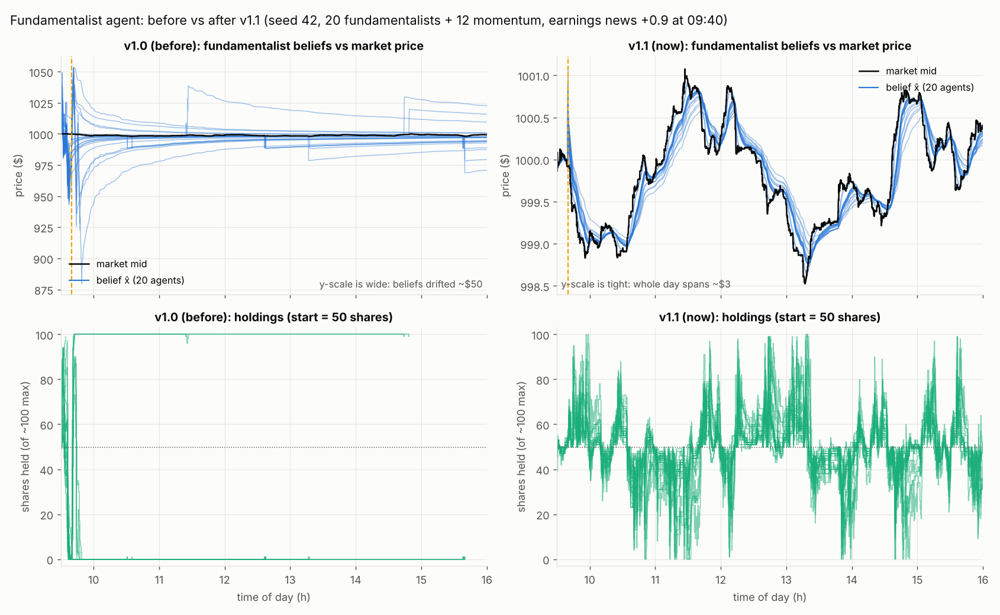
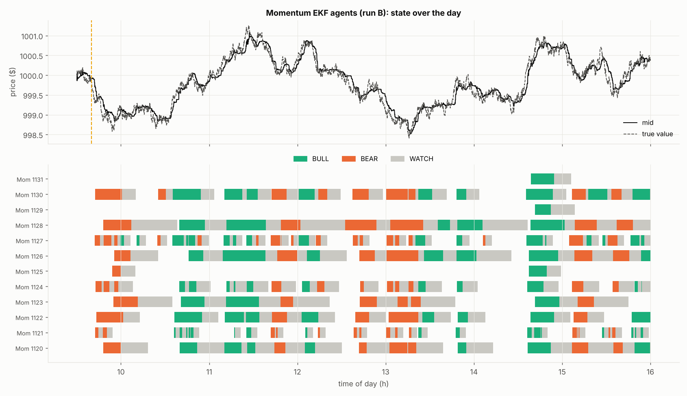
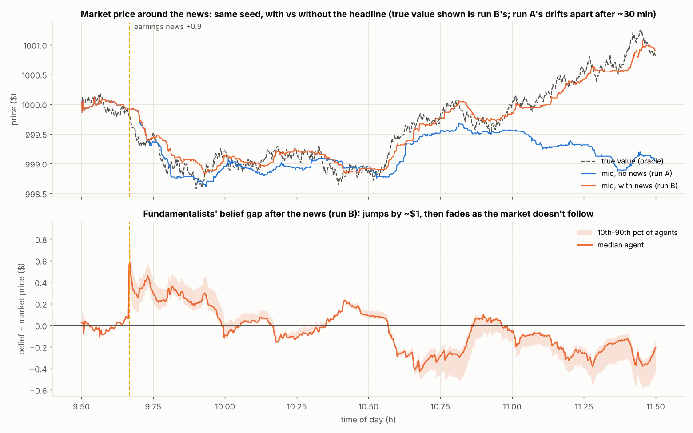
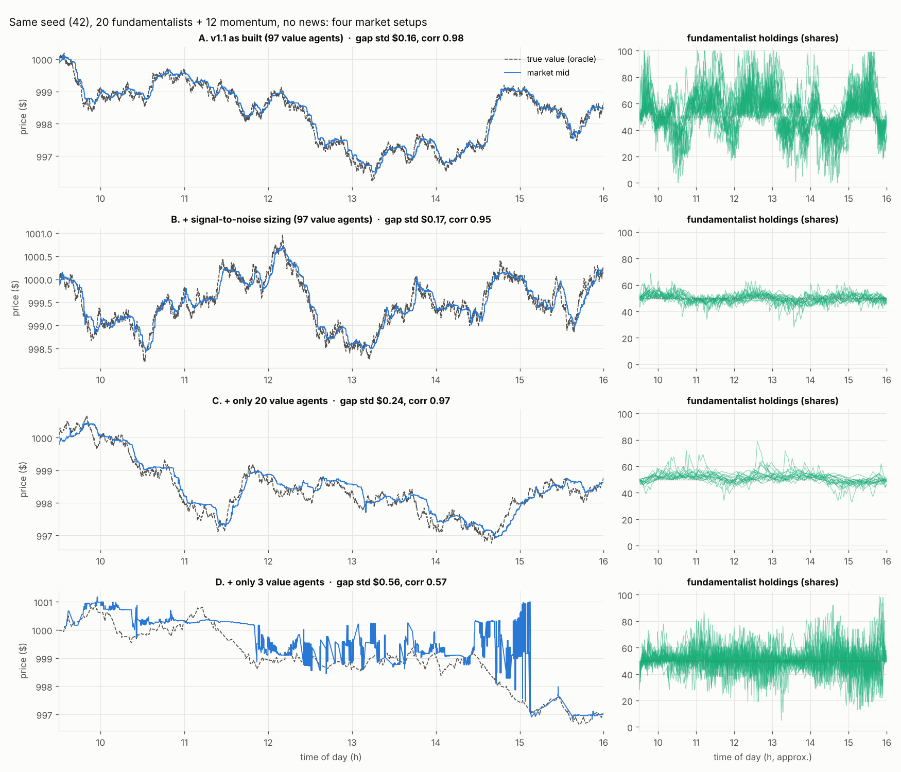

# FinVerse: project journey and engineering log

**Covers:** 25 Sep – 9 Oct 2026 (engine versions v1.0 → v1.1 → v1.2)
**Owner:** Apratim Anand (with Sarthak Agrawal), IIT Bombay, ITSP 2026
**Repository:** [`ApratimAnand336/Abides_market_sim`](https://github.com/ApratimAnand336/Abides_market_sim). Latest branch: `v1.2`
**Written:** 9 Oct 2026, after independently verifying v1.2

This document is the *story* of how the FinVerse engine got to where it is: what we
built, what broke, how each problem was found, what we measured, what we decided and why,
and what we learned. It is meant to be read cold, by a new teammate, a mentor, or a fresh
Claude chat.

It deliberately does **not** repeat the engine reference. For *how things work now*, read
[`docs/engine/`](../engine/README.md) in the repo (architecture, oracle, each agent's maths, the
dated decision log, changelog, known issues, testing). This document links there instead of
copying it.

---

## Contents

1. [How to resume this work in a new chat](#1-how-to-resume-this-work-in-a-new-chat)
2. [The idea in one page](#2-the-idea-in-one-page)
3. [Timeline](#3-timeline)
4. [How we work: the loop](#4-how-we-work-the-loop)
5. [Case studies: problems, investigations, fixes](#5-case-studies-problems-investigations-fixes)
   - 5.1 The dashboard that showed fake data
   - 5.2 The fundamentalist whose beliefs ran away
   - 5.3 A units mistake: variance, not standard deviation
   - 5.4 Designing and repairing the momentum agent
   - 5.5 Overtrading and herding: the edge as a t-statistic
   - 5.6 Who makes money? Zero-sum accounting
   - 5.7 The oracle: what "true value" is, and why it wasn't reproducible
   - 5.8 What happens without value agents
   - 5.9 How realistic is the market? The scorecard
6. [Test and verification record](#6-test-and-verification-record)
7. [Key decisions at a glance](#7-key-decisions-at-a-glance)
8. [Where we are now (v1.2)](#8-where-we-are-now-v12)
9. [Open questions and roadmap](#9-open-questions-and-roadmap)
10. [Lessons learned](#10-lessons-learned)
11. [Non-engine work: pitch deck and incubation](#11-non-engine-work-pitch-deck-and-incubation)
12. [Appendix: formula cheat-sheet, file map, environment notes](#12-appendix)

---

## 1. How to resume this work in a new chat

**Read these, in this order:**

| What | Where | Why |
|---|---|---|
| This document | `docs/journey/README.md` (once you commit it) | context and history |
| Engine reference | `docs/engine/README.md` (index of ten pages) | how everything works now |
| Decision log | `docs/engine/DECISIONS.md` | every decision, dated, with reasons and rejected alternatives |
| Known issues | `docs/engine/KNOWN_ISSUES.md` | what is still unrealistic, with numbers and the plan |
| Specs | `docs/specs/spec_v1.1.txt`, `docs/specs/spec_v1.2.txt` | exactly what was asked of each version |
| Version reports | `docs/v1.1/REPORT.md`, `docs/v1.2/REPORT.md` | what was built, acceptance numbers, deviations |

**Starting prompt for a new chat** (copy and adapt):

> I'm continuing the FinVerse engine work (ABIDES fork, repo ApratimAnand336/Abides_market_sim,
> branch v1.2). Read docs/journey/README.md and docs/engine/README.md first. The next step on the
> roadmap is R2: the realism lab (section 9 of the journey doc). Design it as a spec for
> Claude Code, in the same style as docs/specs/spec_v1.2.txt.

**Should the ABIDES code be removed from the claude.ai project to save space?**
The project's knowledge store hit its size limit on 8 Oct (new docs could not be saved). The
synced GitHub source currently includes the *whole* `main` branch, including upstream ABIDES
code, notebooks (2.1 MB) and tracked simulation logs (about 1 MB). Recommendations:

- **Narrow the sync filter rather than removing it.** Keep `docs/` (all the knowledge lives
  there now), plus `abides-markets/abides_markets/agents/`, `.../configs/`, `.../oracles/`,
  `api/` and `scripts/`. Exclude `notebooks/`, `log/`, `abides-gym/`, `version_testing/` and
  `*.pkl`.
- **Point the sync at the latest branch** (`v1.2`, or `main` after you merge), not the old
  `main`. Today `main` is still at the September commit, so a chat reading the sync sees
  the *old* code.
- A chat that can run code (like the one that wrote this) clones the repo itself, so it
  doesn't depend on the sync. A plain chat does depend on it, but `docs/engine/` gives it
  almost everything it needs.

---

## 2. The idea in one page

**FinVerse** is a simulated stock market for students. Instead of learning to trade with
real money (and losing it), a student practises in a market populated by AI investors that
behave like real market participants and react to the student's actions, alongside a
theory course.

**Why it matters** (sources on the pitch deck's appendix slide):

- Only 27% of Indian adults are financially literate (NCFE survey, 2019).
- Young investors are flooding in: under-30s are 37.9% of NSE's investor base (Aug 2026),
  up from 23.5% in 2020.
- SEBI found 91% of individual F&O traders lost money in FY25.

**The engine:** a fork of [ABIDES](https://arxiv.org/abs/1904.12066), J.P. Morgan's open-source
discrete-event market simulator. ABIDES provides the exchange (a real limit order book with
price-time priority), message passing with latencies, and stock agents (noise traders,
value traders, market makers, a simple momentum trader). FinVerse adds:

- **FundamentalistAgent**: a value investor that tracks a belief about what the stock is
  worth with a Kalman filter.
- **MomentumEKFAgent**: a trend follower that estimates trend *speed and its uncertainty*
  with a two-state Kalman filter and trades through a state machine.
- **NewsOracleAgent**: broadcasts headlines scored by FinBERT sentiment; our agents react.
- **A web dashboard**: a React frontend plus a FastAPI backend that runs real simulations
  and shows every agent's internals.

**The prototype goal:** a market realistic enough to stand on its own, then let a user trade
inside it and see the effects.

---

## 3. Timeline

| Date | What happened | Result |
|---|---|---|
| 25 Sep | First commits on the fork: FundamentalistAgent (scalar Kalman filter, ER-based observation noise, caution modulator), NewsOracleAgent with FinBERT, the `rmsc04_ekf` market config, a Streamlit dashboard | v1.0 base (`9a8fb8c`, `ea3ecf7`) |
| ~1–3 Oct | Codebase walkthrough. The Streamlit dashboard was judged too weak; a Google AI Studio React prototype turned out to show **fake data** (5.1) | decision: build a real dashboard |
| ~3–4 Oct | Momentum agent designed mathematically (warm-up, state, regime shifts, news, volume), written as spec v1.0 | `specs/momentum_agent_spec.txt` |
| 4 Oct | Pitch deck for the incubation judges (22 slides, real simulation charts) | [deck artifact](https://claude.ai/artifact/HU3aDmgsgtCjvTQCqqM9Wf) |
| 5 Oct | Claude Code built MomentumEKFAgent + endowments + the pandas≥2 fix | `539ec6b` (branch `Momentum`) |
| ~5 Oct | Review of the momentum code: v1.1 fixes proposed (5.4) | fixes held for approval |
| 6 Oct | Dashboard spec v1.0 → Claude Code built the FastAPI backend + React frontend (four tabs) in eight milestones | `826ab70 … aa38353` (branch `dashboard`) |
| ~6–7 Oct | Dashboard observations diagnosed: vertical belief lines, everyone losing, dumping at the open, news not sticking (5.2). Incubation form answers drafted | root causes found |
| 8 Oct | Open problems explained (intuition + maths) → spec v1.1 → built → independently verified | branch `v1.1` (`3c0b859`), every target passed |
| 9 Oct | Realism investigation: overtrading/herding, the oracle reproducibility bug, value-agent experiments, P&L analysis (5.5–5.9) → spec v1.2 (R1) → built → independently verified | branch `v1.2` (`aa5f606`), every target passed |

---

## 4. How we work: the loop

```
  owner observes something odd (dashboard, numbers)
        │
        ▼
  Claude investigates: reads the code, reruns the simulation, measures, finds the root cause
        │
        ▼
  explanation for the owner (intuition first, then maths) → owner decides
        │
        ▼
  Claude writes a self-contained spec (context, maths, tests, acceptance targets)
        │
        ▼
  Claude Code implements: one commit per milestone, tests, docs, a report with deviations
        │
        ▼
  Claude verifies independently: reruns the tests and the acceptance runs, runs its own
  experiments, compares the numbers, looks for what the report did not say
        │
        └──► the next round of observations
```

Principles we settled on along the way:

- **Measure, don't guess.** Every claim in a spec or report carries a number and the run
  that produced it (seed, agent counts, date).
- **Don't tune silently.** If an acceptance target is missed, report it; never quietly
  change a parameter to pass.
- **Decisions belong to the owner.** Claude proposes with evidence and a recommendation;
  nothing goes to Claude Code without approval.
- **Document every milestone.** Since v1.2, a milestone is not done until `docs/engine/`
  is updated in the same commit.
- **Verify independently.** Claude Code's reports have been accurate so far (to the cent,
  in v1.1 and v1.2), but the independent rerun also surfaced things the reports never
  mentioned, such as the overtrading in 5.5 and the oracle bug in 5.7.

---

## 5. Case studies: problems, investigations, fixes

### 5.1 The dashboard that showed fake data

**Symptom.** A React dashboard generated in Google AI Studio looked convincing, but its
numbers didn't behave like ABIDES output.

**Investigation.** The app had no backend. When the simulation API wasn't reachable, it fell
back to a JavaScript function (`runNewSimulation`) that **generated synthetic data in the
browser**. The tells: a hard cap of 4,000 points, an "oracle" that changed only every 25
steps, and spreads of 3–25 cents (real ABIDES runs have a median spread of 1 cent).

**Decision.** Build a real dashboard: a FastAPI backend that runs actual simulations, plus a
React + ECharts frontend, matching the AI Studio *layout* but showing real data. Spec:
`specs/dashboard_spec.md` (project doc). Built 6 Oct in eight milestones.

**Lesson.** Check where data comes from before trusting a chart. A UI can look right and be
fiction.

---

### 5.2 The fundamentalist whose beliefs ran away

**Symptoms seen on the dashboard (v1.0):** belief lines (x̂) drew vertical streaks, almost
every agent finished in a loss, the market kept falling after *positive* news, and the
fundamentalists dumped their shares right after the open.

**Reproduction.** Seed 42, 20 fundamentalists, 12 momentum agents, the news "Company announces
record quarterly earnings" (+0.9) at 09:40:

- 19 of 20 fundamentalists sold their whole 50-share endowment 7–19 minutes after the open,
  *before* the news.
- The median agent's lowest belief was about **$949** on a ~$1000 stock.
- One agent's first beliefs: 1000.1 → 1009.5 → 1018.5 → 1027.3 → … (steps of almost exactly 1%).
- The news shifted beliefs by ×1.033 (+$33).
- The "losses" were mostly the endowment being marked to market (for example 50 shares ×
  −$7.20 = −$361.50).

**Root causes (five, all in `fundamental.py`):**

| # | Cause | Why it broke things |
|---|---|---|
| 1 | A ±1% "nudge" after every order: `x_hat *= 1.01` or `0.99`, by the direction of the last tick | $10 per order. To move x̂ $10 through the Kalman update when the gain K ≈ 0.003, the agent would have to see a price about $3,300 away. Tick direction is close to a coin flip, so x̂ random-walked with $10 steps. |
| 2 | No process noise Q | P only shrank, so K = 1/(n + R/P₀) → about 0.0004 by the close. The belief became an all-day average that no new price could move, so nothing could undo the nudges. |
| 3 | Observation noise far too large: R = (δ·price)²·exp(λ(1−ER)), δ ∈ [0.002, 0.015] | The agent believed prices were $2.6–70 off; real noise is cents to tens of cents. |
| 4 | Flow sizing: each wake traded a fraction of holdings, *with a minimum of 1 share whenever x̂ ≠ mid* | 50 shares gone in at most 50 wakes (about 8 minutes), even on a 1-cent gap. |
| 5 | News multiplied the belief: `x_hat *= 1 + sensitivity × sentiment` | Shifts of $5–40, which with tiny K could never be corrected. |

**Fix (spec v1.1, built 8 Oct):** delete the nudge; add Q = q·σ̂_f²·Δt, where σ̂_f² is estimated
from 300-second price changes; smaller δ ∈ [0.0005, 0.003] and λ ∈ [0.5, 2]; target-position
sizing (a holding target from the edge, a step cap, a dead band); and volatility-scaled
additive news, shift = s·k_news·√(σ̂_f²·1800 s), with P += shift². The volatility-scaled news
rule was the owner's idea; the spread was rejected as the scale because it measures liquidity,
not movement.

**Result (verified):** beliefs stay within about $0.13 of the price (median), the worst gap
all day is about $1, K stays near 0.025, no agent dumps its endowment, and news shifts are
$0.28–1.55.


*Figure 1. Left: v1.0 beliefs drift as far as $880–1050 and holdings snap to 0 or 100. Right: v1.1
beliefs track the price (note the much tighter y-scale), but holdings still swing hard,
which led to 5.5.*

---

### 5.3 A units mistake: variance, not standard deviation

While explaining 5.2, Claude first said the fundamentalist's initial guess was "$3–30 off".
That was **wrong**. ABIDES' `observe_price(sigma_n=…)` treats `sigma_n` as a **variance**
in cents² (the source says "NOT STANDARD DEVIATION"). The config draws σ_n ∈ [300, 3000]
cents², so the standard deviation is 17–55 cents. The first guess was already accurate; the
big early errors came from the nudge. The owner had approved "reduce the initial noise"
based on the wrong number, and the item was then deferred.

**Lesson.** State units on every number (cents vs dollars, variance vs std, per second vs per
nanosecond). ABIDES mixes all of these.

---

### 5.4 Designing and repairing the momentum agent

**Design (spec v1.0).** Log-price state [level ℓ, velocity v] with a damped-trend Kalman filter:

- φ = exp(−dt/τ), F = [[1, τ(1−φ)], [0, φ]]
- Q = diag(σ_ℓ²·dt, g_Q·σ_v∞²·(1−φ²)), with σ_ℓ² = κ_ℓ·σ_ref² and σ_v∞ = κ_v·σ_ref/√τ
- **Warm-up:** an OLS fit for the initial state, with self-doubt c_P on P.
- **Observation noise:** R from the Kaufman efficiency ratio.
- **Regime monitor:** innovation statistics inflate Q when the model is surprised.
- **Trend strength:** T = v/√P_vv.
- **State machine:** NEUTRAL / BULL / BEAR / WATCH, with hysteresis (enter at θ_in, leave at θ_out < θ_in).
- **Sizing:** target exposure from conviction, with a staircase ratchet (add only at new highs), urgency and anti-chase limit prices, "primed" news handling, long-only, a 50% endowment.

**Review of the first build** found the agent rarely traded and misjudged trends:

| Finding | Evidence | Fix (v1.1) |
|---|---|---|
| τ drawn independently of wake time | when τ/wake ≤ 5, |T| ≥ 2 was reached **0%** of the time | τ = ratio × wake_mean, ratio ∈ log-U[15, 40] |
| The filter explains trends away as level jumps | worst parameter corner (κ_ℓ = 0.5, κ_v = 0.5) sees only **26–28%** of the true speed | κ_ℓ ∈ [0.02, 0.15], κ_v ∈ [1, 2] → sees 68–92% |
| The trend counted as volatility (raw returns: E[r²/dt] = σ² + v²·dt) | position scale g fell to **0.43** in clean trends (0.81 when detrended) | detrended variance everywhere |
| The ratchet cap only rose | re-bought without a new high | the cap follows down first |
| Re-entry needed only v > 0 | **6 of 9** re-entries reversed within 3 looks | re-entry needs T ≥ θ_out |
| A stop exit was forgotten if its order didn't fill | — | a persistent `exit_pending` flag |

**The trend-bias formula** (derived during review; it explains the 26–28% exactly). At steady
state under a constant ramp, the surprise y* is constant, so (1−φ)·v̂ = K_v·y* and
v·dt = τ(1−φ)·v̂ + K_ℓ·y*. Solving:

```
v̂ / v = dt / ((1−φ)(τ + K_ℓ/K_v))  ≈  τ / (τ + K_ℓ/K_v)
```

K_ℓ/K_v (in seconds) is "how many seconds of trend the filter is willing to explain away as
level jumps". A direct simulation matched the formula exactly (0.692 vs 0.692, 0.054 vs
0.054, 0.198 vs 0.198).

**Result (v1.1, verified):** all 12 agents reach the entry threshold; in strong trends they
estimate 60–83% of the real speed; the position scale in trends is 0.91–0.98.


*Figure 3. v1.1, run with news: each momentum agent's state over the day. Fast agents catch many
short trends; slow agents (long τ, high θ_in) catch one or two.*

---

### 5.5 Overtrading and herding: the edge as a t-statistic

**Found during the v1.1 verification** (not mentioned in the v1.1 report): each fundamentalist
traded a median of **about 1,900 shares a day** on a 50-share endowment (range 493–6,692),
swinging between 0 and 100 shares, **all 20 in sync**. Together they placed more orders than
all 97 value agents.

**Cause.** The edge was z = gap/√P. √P is the agent's uncertainty about its own belief (about
30 cents), which is small because the belief averages many prices. It ignores how much the
*price itself* wiggles (√R ≈ $2.09 median). A normal 13-cent wiggle gave z = 0.43, worth about
9 shares. Herding followed: all 20 watch the same price through similar lagging filters, so
after every dip all their beliefs sit above the price at the same moment, and they all buy.

**Fix (the owner's framing: "signal over noise"):** z = gap/√(P + R). P + R is the variance of
(belief − price) when nothing is mispriced, so z is a t-statistic. The same 13-cent gap gives
z = 0.06, below the minimum trade size, so the agent holds.

**Experiment (same seed, only this change):**

| | seed 42 before → after | seed 7 before → after |
|---|---|---|
| shares traded per fundamentalist per day | 2,027 → 168 | 3,388 → 231 |
| holdings, 10th–90th percentile | 35–73 → 46–54 | 28–80 → 47–57 |
| loss vs just holding (median) | −$108 → −$5 | −$82 → −$13 |
| all trades in the market | 22,508 → 14,209 | 22,389 → 13,330 |

Built in v1.2. Verified: median 166–192 shares per agent per day; holdings 46–55.

---

### 5.6 Who makes money? Zero-sum accounting

The owner asked why everyone seemed to lose, and why the momentum agents traded so little.

**Two kinds of P&L.** Our agents start with 50 shares, so *total* P&L includes the price
move. On seed 7 the price fell $3.40, so every 50-share holder lost about $170 without
trading. **P&L vs holding** = final value − (starting cash + starting shares × closing
price) isolates the agent's decisions. Summed over all agents it is **exactly $0** in every
run, because trading only moves money between agents.

**Who wins** (trading P&L per agent; v1.1 runs and the new-sizing experiments):

| Group | Typical result | Why |
|---|---|---|
| Value agents (97) | +$18 to +$256 | the only agents who see the true value |
| Momentum EKF (12) | +$12 to +$40 | small trend profits |
| Noise (1000) | about $0 | random |
| Fundamentalists (20) | −$8 to −$103 (−$3 to −$5 after v1.2) | no information edge; they lag the price and pay the spread |
| Market makers (2) | −$1.3k to −$12k each | picked off by informed traders (adverse selection); inventory skew is switched off (`mm_skew_beta = 0`) |

**Why the amounts are tiny.** The whole day moves only $2–4 on a $1000 stock. With about 50
shares, perfect timing could make perhaps $200. Small P&L is a symptom of the calm market
(5.9), not of the agents.

**Why momentum trades rarely:** about half their decisions happen in NEUTRAL; 88% of decisions
are skipped by the dead band (a target change under 10% of wealth); personalities vary
(1–40 entries a day); and the market barely trends.

**Design consequence:** a realistic market needs *some* group that wins consistently. That
will be our fundamentalists once they get an information edge (R3 research channel); and the
market makers should break even once inventory management is on (R4).

---

### 5.7 The oracle: what "true value" is, and why it wasn't reproducible

**What it is (the owner initially assumed historical data).** ABIDES' oracle invents the
company's hidden true value with a random process: Ornstein–Uhlenbeck with a negligible
pull to $1000, plus "megashocks" that arrive on average about every 11 years, so effectively
never. Its docstring: *"Historical dates are effectively meaningless to this oracle. It is
driven by the numpy random number seed."*

Two different things exist in the simulator:

- **market price**: made by orders in the book. All dynamics (volatility, trends, crashes)
  must come from here.
- **true value**: what the company is worth. Nobody sees it exactly; informed traders
  estimate it.

Historical prices are *market prices*, so using them as the true value would make agents
replay history. They are kept as a future optional "path source" (replaying a real
stock's shape).

**The bug.** The oracle generated the value *lazily*: each time an agent asked, it drew one
random number conditioned on the time since the last question. The statistics were right,
but the actual path depended on *how many* questions were asked and *when*. Same seed,
with vs without news: identical for 10 minutes, $0.10 apart at 30 minutes, about **$2 apart
after 2 hours**. A "with vs without news" comparison was therefore confounded. Worse, a
user's trade would have changed the company's true value. Megashock timing also used
numpy's global RNG.

**Fix (v1.2):** `PregeneratedOracle` generates the whole 09:30–16:00 path at construction on a
1-second grid (23,401 points), with the exact OU step, from one dedicated RNG. It serves the
value as a step function (no look-ahead) and has pluggable path sources.

**Verified:** runs A (no news), B (news) and Z (no value agents at all) have a
**bit-identical** true-value path; a different seed gives a different one.


*Figure 2. v1.1 (before the oracle fix). Top: with vs without news, the price paths diverge,
but part of that divergence is the true value itself diverging. Bottom: fundamentalists'
beliefs jump by about $0.55 at the news, then fade over about 20 minutes as the market doesn't
follow.*

---

### 5.8 What happens without value agents

**Experiment** (new sizing, 20 + 12 of our agents, seeds 42 and 7):

| Value agents | 97 | 20 | 3 | 0 |
|---|---|---|---|---|
| price − value gap std | $0.13–0.17 | $0.23–0.24 | $0.43–0.56 | — |
| half-life of a mispricing | 1.2–1.7 min | 3.9–4.1 min | 4.8–6.5 min | — |
| corr(price, value) | 0.95–0.99 | 0.97–0.99 | 0.54–0.57 | — |
| trades per day | ~14k | ~5k | 3.7k–5.4k | **0** |
| market-maker orders | 18,680 | — | **0** | — |

**Findings:**

1. **Fewer value agents ≠ a more natural market.** 20 looks the same, just quieter; 3 is broken
   and illiquid (flat stretches, then jumps; spreads up to $1.37); 0 never trades at all.
2. **Value agents do three jobs:** information (they see the true value), volume (about 83%
   of it), and *starting the market* (the only agents that will post into an empty book).
3. **A market-maker death bug in stock ABIDES:** if the book is empty at its first wake, the
   AdaptiveMarketMaker has no mid, places nothing, **and never schedules another wake**.
4. **(Found by Claude Code while building v1.2)** Without value agents, the market maker
   watches its own spread, and its adaptive spread estimate ran away geometrically (1.6¢ →
   $46.50 in 10 minutes). A cap (`max_spread = 100¢`) stops it; with value agents present it
   never binds.

**Fix (v1.2):** a market-maker cold start from a reference price ("yesterday's close"), always
rescheduling, the spread cap. Verified: the market now runs all day with zero value agents
(2,539 trades, both market makers alive). That market is unstable (1-min volatility 9×
higher, kurtosis 209, correlation with value −0.18; in a 1-hour probe with fewer of our agents
it slid to about $589). It is the baseline for R3.


*Figure 4. Same seed, four setups. A: v1.1 sizing (holdings swing). B: t-statistic sizing (calm
holdings). C: 20 value agents. D: 3 value agents (an illiquid, broken market). The dashed
true-value line differs between panels: that is the lazy-oracle bug of 5.7, fixed in v1.2.*

---

### 5.9 How realistic is the market? The scorecard

Compared with the standard "stylized facts" of liquid stocks (R. Cont, *Quantitative
Finance*, 2001); numbers are from v1.2, runs A–C:

| Property | Ours | Real (approx.) | Status |
|---|---|---|---|
| 1-min return volatility | 0.62–0.70 bps (~2%/year) | ~15–40%/year | **too calm (~10×)** |
| 1-min return autocorrelation (lag 1) | +0.33 to +0.40 | ~0 | **predictable** |
| volatility clustering (\|r\| lag-1) | 0.05–0.20 | clearly positive, slow decay | weak |
| fat tails (excess kurtosis) | 1.8–3.4 | usually well above 0 | borderline |
| spread | ~1.4¢ mean, 1 tick typical | 1 tick for liquid stocks | OK |
| price vs value | half-life ~1.3 min, corr ~0.99 | mispricings last much longer | **too tight** |
| regimes (calm / trending / stressed) | wildest 30 min only 2–3× the quietest | clear | **absent** |
| news moves prices | barely | yes | **no** |
| price impact of big orders | not measured | ~√(order size) | **unknown; needed for users** |

**Root causes:** the true value is a calm, smooth process; 97 informed agents pin the price
to it; everything is constant in time (arrival rates, volatility, agent mix); and information
never arrives as an event. Regimes can't emerge from a system whose drivers never change
state. Full list and status: `docs/engine/KNOWN_ISSUES.md`.

---

## 6. Test and verification record

### 6.1 Test suites

| Version | Claude Code's run | Independent rerun (Claude) | Notes |
|---|---|---|---|
| v1.1 | 147 passed | 55 agent + 22 export passed | 2 pre-existing upstream failures (`test_gym_runner`: no gym; `test_ou_process`: pandas) |
| v1.2 | 169 passed, frontend build passes | 99 passed (fundamental, momentum, oracle, market maker, invariants I1–I7, export) | same pre-existing failure; the API server tests and the frontend build couldn't run in Claude's environment (6.4) |

The **invariants** (since v1.2) guarantee: the same seed gives the same result (checked
across processes with different hash seeds); the true value never depends on market
activity; cash and shares are conserved; our agents never go negative; the book never
crosses; the market runs without value agents; the market makers never go silent.

### 6.2 Acceptance runs

**Standard runs:** a full day 09:30–16:00, 20 fundamentalists + 12 momentum EKF agents.
A = seed 42; B = seed 42 + earnings news (+0.9) at 09:40; C = seed 7; Z = seed 42 with no value
agents.

**v1.1 (8 Oct)**, every target passed; the independent rerun matched to the cent:

| Target | A | B |
|---|---|---|
| median of per-agent median \|x̂ − mid\| < $1 | $0.135 | $0.127 |
| max \|x̂ − mid\| < $5 (excluding news) | $1.02 | $0.80 |
| median K, last hour > 0.003 | 0.025 | 0.031 |
| agents ending at 0 shares | 0 | 0 |
| momentum agents reaching θ_in | 12/12 | 12/12 |
| re-entries reversed within 3 looks | 21% | 19% |
| median position scale in trends | 0.91 | 0.98 |

**v1.2 (9 Oct)**, every target passed; the independent rerun matched exactly:

| Target | A | B | C |
|---|---|---|---|
| shares traded per fundamentalist per day ∈ [100, 400] | 192 | 186 | 166 |
| holdings, 10th–90th percentile within [35, 65] | 46–53 | 46–53 | 46–55 |
| time at 0 or 100 shares | 0% | 0% | 0% |
| median \|x̂ − mid\| < $1 | $0.11 | $0.12 | $0.15 |
| median K, last hour > 0.003 | 0.015 | 0.017 | 0.014 |
| true-value path identical A = B (= Z) | yes (bit-identical) | | |
| run Z trades all day, both market makers alive | 2,539 trades; 397 and 385 of 390 expected wakes | | |

### 6.3 Experiments run outside the specs

| Date | Experiment | Question | Answer |
|---|---|---|---|
| ~5 Oct | grid over (κ_ℓ, κ_v, τ/wake) on replayed prices | why momentum rarely trades | τ/wake ≤ 5 → 0% reachability; trend bias 26–28% at the worst corner |
| 8 Oct | v1.0 vs v1.1, same seed and news | did v1.1 fix the fundamentalist? | yes (Figure 1), but exposed the overtrading |
| 8 Oct | v̂ vs realised slope over τ | does the momentum agent see trends now? | 60–83% of the speed in strong trends |
| 8 Oct | oracle A vs B | is "with vs without news" a clean comparison? | no: the value differs by $2 after 2 h (lazy oracle) |
| 9 Oct | z = gap/√P vs gap/√(P+R), two seeds | does the t-statistic edge fix overtrading? | yes: turnover 12–15× lower |
| 9 Oct | 97 / 20 / 3 / 0 value agents | does removing them make the market natural? | no; found the bootstrap dependency and the market-maker death bug |
| 9 Oct | P&L by group, four runs | who makes money? | value agents win, market makers lose, the sum is exactly $0 |
| 9 Oct | personality of the one v1.2 overtrader | a bug? | no: the most aggressive corner of every range at once (smallest R, a_max 0.99, dead band 1.2 shares) |

### 6.4 Environment notes for reproducing

Claude's cloud workspace couldn't reach PyPI or npm (proxy policy: 403), so pytest, FastAPI
and the frontend packages couldn't be installed there. Agent and export tests were run with a
minimal pytest stand-in, and simulations with ABIDES on `PYTHONPATH`. Claude Code (on the
owner's machine) runs the full suite and the frontend build. To reproduce acceptance:
`python scripts/acceptance_v1_2.py --run A|B|C|Z`, then `--report`.

---

## 7. Key decisions at a glance

Full, dated log with reasons and rejected alternatives: `docs/engine/DECISIONS.md`.

| Area | Decision |
|---|---|
| Dashboard | Real React + FastAPI dashboard running real simulations (not Streamlit, not the fake-data prototype) |
| Our agents | Start with 50% of wealth in stock, so they can sell as well as buy; long-only |
| Fundamentalist | No nudge; Q = q·σ̂_f²·Δt; small δ; target-position sizing; **edge z = gap/√(P+R)** |
| News | Additive shift scaled by the stock's typical 30-min move, with P += shift² (the owner's idea) |
| Momentum | Damped-trend Kalman filter + state machine; v1.1 parameter and logic fixes (5.4) |
| Oracle | Synthetic (not historical) true value, **pre-generated and seed-stable**; historical data kept as a future option |
| Market makers | Cold start from a reference price; always reschedule; spread cap |
| Value agents | Keep as scaffolding for now; replace with informed fundamentalists in R3 |
| Process | Spec → Claude Code → independent verification; no silent tuning; docs every milestone |
| Deferred | skewed initial noise; self-calibrating R; safety margin in σ units; two news types; herding tilt |

---

## 8. Where we are now (v1.2)

**Works and is verified:**

- Our agents behave sensibly: they track the price, don't drift or dump, trade moderately,
  momentum agents catch trends, and news effects are sized sensibly.
- The true value is reproducible: the same seed gives the same company value whatever
  happens in the market. That is the precondition for user trading and for clean
  scenario comparisons.
- The market starts and runs without value agents (at least one market maker needed).
- Invariant tests guard determinism, conservation and book sanity.
- The dashboard shows real runs, a population table, price vs value, and P&L vs holding.
- Documentation lives with the code (`docs/engine/`).

**Not yet realistic (5.9):** too calm, predictable 1-minute returns, no regimes, news barely
matters, the market is pinned to value by 97 value agents, market makers lose every day, and
our fundamentalists have no information edge.

**Is the first iteration (R1) a success?** Yes, against what it set out to do. Every
acceptance target passed, the numbers reproduce exactly, and the three structural bugs (lazy
oracle, market-maker death, no-bootstrap) are closed. Claude Code also found and fixed a fourth
(the spread runaway) and documented it. R1 was never meant to make the market realistic; it
makes realism *testable*.

---

## 9. Open questions and roadmap

### 9.1 Open questions (from the v1.2 report and verification)

1. **Kurtosis.** The 9 Oct experiment measured 6.7–8.0 with the new sizing; v1.2 measures
   1.8–3.4. The experiment ran on the old lazy-oracle path, so this is a single-path
   statistic, and those are noisy. Treat kurtosis as a 20-seed scorecard item in R2, not a
   single-run target.
2. **One "active trader" fundamentalist per run** (687–1,456 shares a day vs a median of about
   190). Cause: the most aggressive corner of every personality range at once. Decide in R2
   whether that personality is wanted, or narrow the ranges (or floor R).
3. **Market makers lose $3k–17k a day together.** Inventory skew is planned for R4.
4. **The market without value agents is unstable.** This is the R3 baseline; our
   fundamentalists need research and the ability to quote into an empty book.
5. **Payload about 8.4 MB** for a full day, over the old 8 MB budget.

### 9.2 Roadmap

| Step | What | Why |
|---|---|---|
| **R2** | **Realism lab:** a scorecard (stylized facts over 20 seeds), scenario tests (value jump, information vs hype news, volatility burst, market makers off, momentum-heavy mix, **a big external order**), a dashboard view | measure before changing; the price-impact test previews user trading |
| R3 | Informed fundamentalists: a research channel (noisy true-value readings every few minutes, varied by agent), quoting into an empty book, budget limits for the ABIDES agents; replace value agents step by step (97 → 50 → 20 → 0), re-measuring each step | give the market an informed group that isn't scaffolding |
| R4 | Value dynamics: information news moves the value (two news types); calm/stressed volatility periods; market-maker inventory management | let regimes emerge |
| R5 | Calibrate against the scorecard bands across seeds | realism with numbers behind it |
| R6 | **User trading:** pause/step the kernel; a "human agent" fed by the UI; counterfactual "what if I hadn't traded" | the prototype goal |

**Owner decisions still pending:** target bands (how far price should stray from value, the
gap half-life, daily volatility, for example 1–2% like a large-cap stock); which regimes the
prototype must show first (suggested: trends, calm vs volatile, big-order impact); and budget
limits for the ABIDES agents (suggested: yes, in R3).

---

## 10. Lessons learned

**About markets and modelling**

1. **A Kalman filter without process noise stops learning.** K → 1/n turns any filter into an
   all-day average. Q is "how much can the truth move between looks", and it should scale
   with time.
2. **Every heuristic outside the filter has to be checked against the filter's scale.** A
   1% nudge is invisible in prose and enormous next to K·y.
3. **Signal must be measured against noise, not against your own confidence.** gap/√P
   overtraded; gap/√(P+R) is a t-statistic.
4. **Trend followers explain trends away** when level noise is plausible: v̂/v ≈ τ/(τ + K_ℓ/K_v).
   Derive the bias; don't guess it.
5. **Trends contaminate volatility estimates** (E[r²/dt] = σ² + v²dt). Detrend.
6. **Trading is zero-sum.** If "everyone loses", someone isn't in the table. Here it was the
   value agents and the market makers. Always show P&L *vs holding*.
7. **Fewer informed traders ≠ more natural.** Informed agents provide information, liquidity
   *and* the first prices. Replace all three jobs, not just the agent.
8. **Lazy random generation breaks counterfactuals.** Anything that should be "the same
   world" across runs must be generated up front from its own RNG.
9. **The oracle is a value, not a price.** Market dynamics must emerge from agents; the oracle
   only supplies the information environment.

**About process**

10. **Verify data provenance** (5.1) and **units** (5.3).
11. **Single-seed statistics mislead.** Kurtosis moved from ~7 to ~2–3 with a different path.
    Realism claims need many seeds.
12. **Independent verification pays.** Reports were accurate, but every verification round
    surfaced something new: overtrading after v1.1; the oracle bug and the market-maker death
    after the experiments.
13. **Specs that state targets, units, tests and "report, don't tune"** produced clean
    implementations and honest deviation lists.
14. **Documentation as a deliverable** (from v1.2) keeps history from living only in chat
    windows.

---

## 11. Non-engine work: pitch deck and incubation

- **Incubation pitch deck** (4 Oct): 22 slides. Problem (financial literacy, young investors
  losing money in F&O), solution (a simulated market of AI investors that reacts to the
  student), proof (real simulation charts: price vs true value, news reaction), status, users,
  competition (Zerodha Varsity, StockGro), business model, roadmap, metrics, the ask. Rules
  followed: no AI-generated stock images, only real simulation output, every statistic sourced
  (appendix slide). [Open the deck](https://claude.ai/artifact/HU3aDmgsgtCjvTQCqqM9Wf).
- **Incubation application form**: answers drafted and reviewed for sections 3.7–6.6
  (including the Level 1 goal, 5.1 and 5.2), kept to measured facts about the prototype. The
  final text lives with the owner, not in the repo.

---

## 12. Appendix

### 12.1 Formula cheat-sheet (current, v1.2)

**Fundamentalist** (scalar Kalman filter on the market mid, cents):
```
predict:   x̂⁻ = x̂,   P⁻ = P + Q,   Q = q · σ̂_f² · Δt          (σ̂_f² from 300 s price changes)
noise:     R = (δ · mid)² · exp(λ_ER · (1 − ER))
correct:   K = P⁻/(P⁻ + R),  x̂ = x̂⁻ + K(mid − x̂⁻),  P = (1 − K)P⁻
edge:      z = (x̂ − mid) / √(P + R)                              (a t-statistic, v1.2)
target:    w* = clip(0.5 + a_max · C · tanh(z/z0), 0, 1);  trade toward w*, step cap s_max, dead band b_f
news:      shift = s · k_news · √(σ̂_f² · 1800);  x̂ += shift;  P += shift²
```

**Momentum EKF** (log price z):
```
φ = e^(−dt/τ);  F = [[1, τ(1−φ)], [0, φ]];  Q = diag(κ_ℓ σ_ref² dt, g_Q κ_v² σ_ref²/τ · (1−φ²))
T = v̂ / √P_vv ;  enter at |T| ≥ θ_in (with a breakout), leave at |T| < θ_out
steady-state trend seen:  v̂/v ≈ τ / (τ + K_ℓ/K_v);   τ = ratio · wake_mean, ratio ∈ [15, 40]
```

**Oracle** (true value, cents; 1-second grid, generated once):
```
v_{k+1} = r̄ + (v_k − r̄)·a + √(fund_vol²/(2κ) · (1 − a²)) · ε_k,   a = e^(−κ·Δ)
measured: about 1.6–1.9 ¢/√s; a day spans about $2–4
```

### 12.2 File map (the parts we touch)

| Path | What |
|---|---|
| `abides-markets/abides_markets/agents/fundamental.py` | FundamentalistAgent |
| `abides-markets/abides_markets/agents/momentum_ekf.py` | MomentumEKFAgent |
| `abides-markets/abides_markets/agents/market_makers/adaptive_market_maker_agent.py` | market maker (cold start, spread cap) |
| `abides-markets/abides_markets/oracles/pregenerated_oracle.py` | the seed-stable true value |
| `abides-markets/abides_markets/configs/rmsc04_ekf.py`, `param_ranges.py` | the market and personality ranges |
| `abides-markets/tests/` | unit tests, `test_invariants.py`, `sim_helpers.py` |
| `api/` | FastAPI backend: export, stats, jobs, schema |
| `web/src/` | React dashboard |
| `scripts/acceptance_v1_1.py`, `acceptance_v1_2.py` | acceptance runs |
| `docs/engine/`, `docs/specs/`, `docs/v1.1/`, `docs/v1.2/` | documentation, specs, reports |

### 12.3 Where things live outside the repo

- claude.ai project "Apratim-Startup": `specs/dashboard_spec.md` (the project store is full; see section 1).
- Pitch deck artifact (link in section 11).
- Explanation documents shared in chat: `finverse_open_problems.txt` (8 Oct, intuition and
  maths of the v1.1 problems) and `finverse_realism_status.txt` (9 Oct, the realism scorecard
  and test plan). Commit them to `docs/journey/` too if you want everything in one place.
