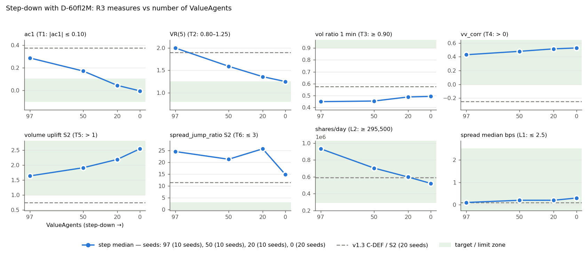
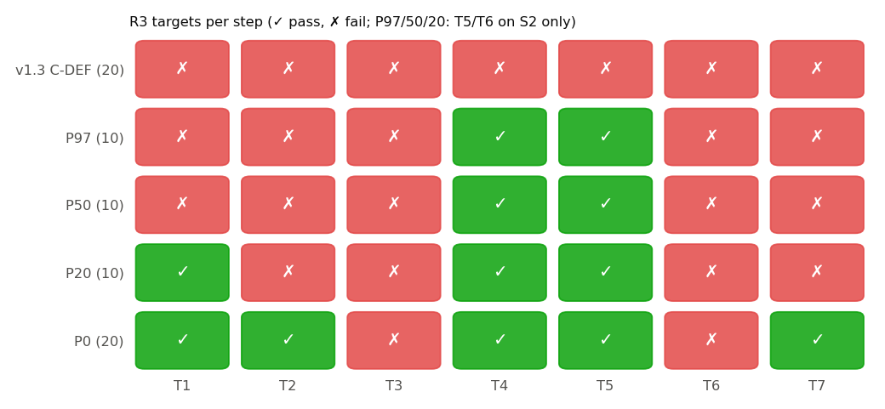
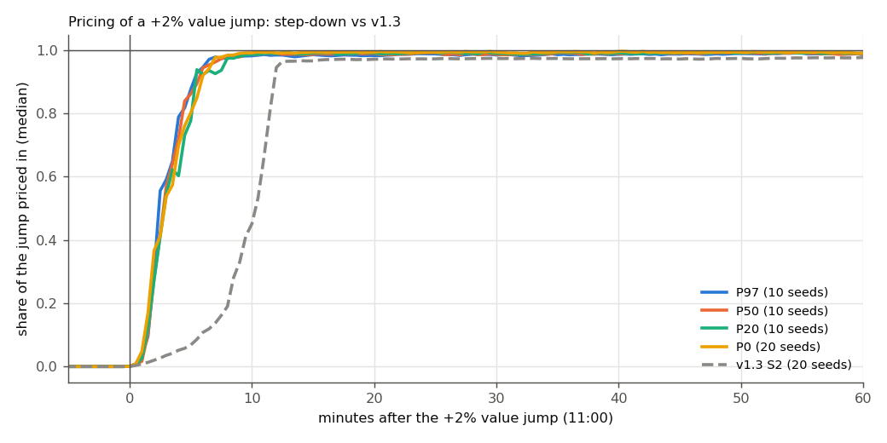
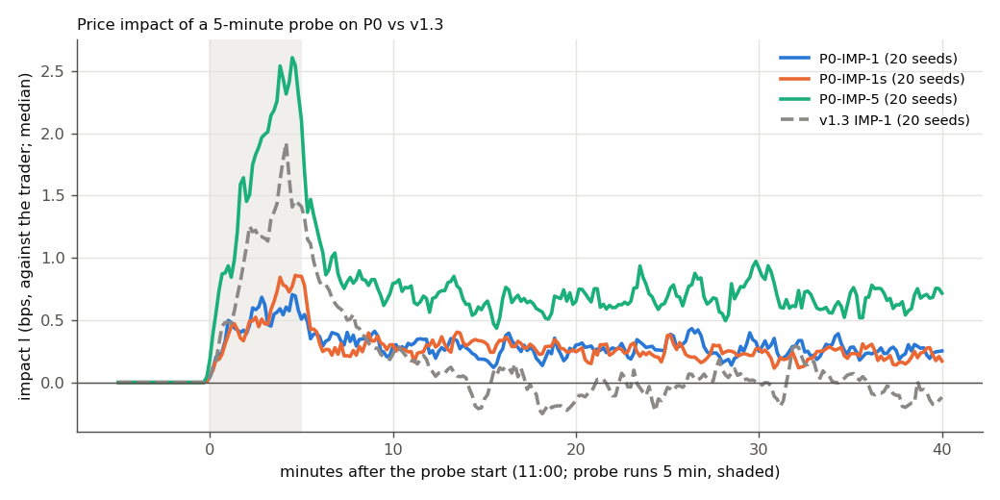

# N5: step-down and final campaigns (spec v1.4.2 Part 2)

Design D-60fl2M (learning off), budget L=2, full day. Runs: engines ['v1.3-c1dfa51'], dates ['2026-10-13', '2026-10-14']; report generated 2026-10-14. **Seeds: P97, P50, P20 use 10 seeds ([42, 7, 1, 2, 3, 4, 5, 6, 8, 9]); P0 uses the 20 lab seeds.** The 10-seed medians are about 1.4× noisier; they show the trend and decide nothing. Every R3 pass/fail is judged on P0 with 20 seeds. v1.3 reference = C-DEF/S2/S2n (97 ValueAgents, 20 price-only fundamentalists, no budget, 20 seeds).

## 1. R3 scorecard on the final market P0 (20 seeds)

| item | check | value | threshold | result |
|---|---|---|---|---|
| **T1** |ac1| of 1-min returns | C ac1 abs<= | -0.00496 | 0.1 | PASS |
| **T2** VR(5) | C vr5 >= | 1.25 | 0.8 | PASS |
| **T2** VR(5) | C vr5 <= | 1.25 | 1.25 | PASS |
| **T3** price vol / value vol | C vol_ratio_price_value >= | 0.493 | 0.9 | FAIL |
| **T4** volume-volatility Spearman | C vv_corr > | 0.528 | 0 | PASS |
| **T5** volume uplift after a ±2% jump | S2 volume_uplift > | 2.54 | 1 | PASS |
| **T5** volume uplift after a ±2% jump | S2n volume_uplift > | 2.58 | 1 | PASS |
| **T6** no emptied book during a jump | S2 one_sided_share_jump <= | 0 | 0.01 | PASS |
| **T6** no emptied book during a jump | S2 spread_jump_ratio <= | 14.8 | 3 | FAIL |
| **T6** no emptied book during a jump | S2n one_sided_share_jump <= | 0 | 0.01 | PASS |
| **T6** no emptied book during a jump | S2n spread_jump_ratio <= | 16 | 3 | FAIL |
| **T7** informed fundamentalists earn their information ($) | C fund_pnl_total > | 1,023 | 0 | PASS |
| **T7** informed fundamentalists earn their information ($) | C fund_pnl_median > | 112 | 0 | PASS |
| **L1** spread (bps of the mid; spec v1.4.1) | C spread_med_bps <= | 0.299 | 2.5 | PASS |
| **L1** spread (bps of the mid; spec v1.4.1) | C spread_p95_bps <= | 0.998 | 10 | PASS |
| **L2** shares executed per day | C shares_executed >= | 522,042 | 295500 | PASS |
| **L3** trades all day with num_value = 0 (share of half-hours with trades) | C active_halfhours_share >= | 1 | 1 | PASS |
| **L4** zero_sum = 0 in every run (1 = yes) | C zero_sum_all_zero >= | 1 | 1 | PASS |
| **L5** median wall time of a full day (s) | C wall_time_s <= | 27.2 | 90 | PASS |
| **L6** no runaway herding: max |mid − value| over the day ($; spec v1.4.1) | C max_abs_gap <= | 0.776 | 10 | PASS |

Summary: T1 PASS, T2 PASS, T3 FAIL, T4 PASS, T5 PASS, T6 FAIL, T7 PASS, L1 PASS, L2 PASS, L3 PASS, L4 PASS, L5 PASS, L6 PASS
L3 part 2 (P0 without market makers, 5 seeds): executions per day [19582, 20411, 20436, 23332, 22244] → PASS (trades > 0).

## 2. Step-down 97 → 50 → 20 → 0 ValueAgents

| measure | v1.3 C-DEF (20 seeds) | P97 (10 seeds) | P50 (10 seeds) | P20 (10 seeds) | P0 (20 seeds) |
|---|---|---|---|---|---|
| T1 ac1 | 0.374 | 0.286 | 0.17 | 0.0438 | -0.00496 |
| T2 VR(5) | 1.9 | 2 | 1.59 | 1.36 | 1.25 |
| T3 vol ratio 1 min | 0.577 | 0.449 | 0.454 | 0.488 | 0.493 |
| T4 vv_corr | -0.252 | 0.429 | 0.479 | 0.515 | 0.528 |
| T5 volume uplift S2 | 0.746 | 1.63 | 1.91 | 2.18 | 2.54 |
| T5 volume uplift S2n | 0.763 | — | — | — | 2.58 |
| T6 one-sided S2 | 0 | 0 | 0 | 0 | 0 |
| T6 spread_jump_ratio S2 | 11.4 | 24.5 | 21.3 | 25.7 | 14.8 |
| T6 spread_jump_ratio S2n | 9.24 | — | — | — | 16 |
| T7 fund P&L total $ | -112 | -12,418 | -6,946 | -2,877 | 1,023 |
| T7 fund P&L median $ | -2.92 | -57.4 | -44.3 | 47.5 | 112 |
| L1 spread median bps | 0.1 | 0.1 | 0.2 | 0.2 | 0.299 |
| L1 spread p95 bps | 0.3 | 0.5 | 0.6 | 0.85 | 0.998 |
| L2 shares/day | 591,360 | 933,368 | 704,146 | 597,716 | 522,042 |
| L5 wall time s | 25 | 73 | 28.7 | 27.6 | 27.2 |
| L6 max |gap| $ | 0.585 | 0.655 | 0.705 | 0.724 | 0.776 |
| σ 1 min bps (G1) | 0.712 | 0.573 | 0.573 | 0.585 | 0.62 |
| VR(30) | 2.14 | 2.77 | 2.61 | 2.2 | 2.17 |
| vol ratio 15 / 30 / 60 min | 0.928 / 0.949 / 0.963 | 0.784 / 0.871 / 0.92 | 0.768 / 0.844 / 0.901 | 0.764 / 0.847 / 0.893 | 0.747 / 0.844 / 0.903 |
| gap std $ | 0.145 | 0.162 | 0.174 | 0.19 | 0.197 |
| half-life read → corrected (min) | 1.65 / 1.6 min | 2.67 / 2.6 min | 3.06 / 3.1 min | 3.54 / 3.5 min | 3.58 / 3.6 min |
| gap mean $ | 0.0137 | -0.0137 | -0.0128 | -0.0165 | -0.0122 |
| t50 / t90 S2 min | 10.4 / 11.8 | 2.21 / 4.9 | 2.62 / 4.66 | 2.52 / 5.17 | 2.62 / 5.64 |
| informed updated +2 / +5 / +10 min (S2) | 0 / 0 / 0 | 0.0167 / 0.358 / 0.883 | 0.025 / 0.358 / 0.875 | 0.00833 / 0.283 / 0.842 | 0.0167 / 0.333 / 0.858 |

R3 targets per step (P97/50/20: T5, T6 on S2 only; P0: S2 and S2n):

| step (seeds) | T1 | T2 | T3 | T4 | T5 | T6 | T7 | limits failed |
|---|---|---|---|---|---|---|---|---|
| v1.3 C-DEF (20) | FAIL | FAIL | FAIL | FAIL | FAIL | FAIL | FAIL | none |
| P97 (10) | FAIL | FAIL | FAIL | PASS | PASS | FAIL | FAIL | none |
| P50 (10) | FAIL | FAIL | FAIL | PASS | PASS | FAIL | FAIL | none |
| P20 (10) | PASS | FAIL | FAIL | PASS | PASS | FAIL | FAIL | none |
| P0 (20) | PASS | PASS | FAIL | PASS | PASS | FAIL | PASS | none |

v1.3 scorecard (bands G1, G3–G11; median, grade):

| band | v1.3 C-DEF | P97 (10) | P50 (10) | P20 (10) | P0 (20) |
|---|---|---|---|---|---|
| G1 1-min volatility | 0.712 FAIL | 0.573 FAIL | 0.573 FAIL | 0.585 FAIL | 0.62 FAIL |
| G3 Return predictability |ac1| | 0.374 FAIL | 0.286 FAIL | 0.17 WARN | 0.0438 PASS | -0.00496 PASS |
| G4 Variance ratio VR(5) | 1.9 FAIL | 2 FAIL | 1.59 WARN | 1.36 WARN | 1.25 PASS |
| G5 Volatility clustering (CS, PS) | 0.0381; 0.000526 FAIL | 0.0843; 0.0253 WARN | 0.0786; 0.0178 WARN | 0.108; 0.0285 WARN | 0.0872; 0.0317 WARN |
| G6 Fat tails (excess kurtosis) | 3.02 PASS | 1.1 WARN | 1.44 WARN | 1.39 WARN | 1.47 WARN |
| G7 Volume–volatility correlation | -0.252 FAIL | 0.429 PASS | 0.479 PASS | 0.515 PASS | 0.528 PASS |
| G8 Spread (median, p95) | 0.1; 0.3 PASS | 0.1; 0.5 PASS | 0.2; 0.6 PASS | 0.2; 0.85 PASS | 0.299; 0.998 PASS |
| G9 Mispricing size (gap std) | 0.145 FAIL | 0.162 FAIL | 0.174 FAIL | 0.19 FAIL | 0.197 FAIL |
| G10 Mispricing half-life | 1.57 FAIL | 2.63 FAIL | 3.05 FAIL | 3.54 FAIL | 3.58 FAIL |
| G11 Regime contrast | 2.39 FAIL | 2.47 FAIL | 2.33 FAIL | 2.76 FAIL | 2.47 FAIL |

Per-class volume share % and P&L vs holding ($, total per run; medians):

| class | P97 vol % | P97 P&L | P50 vol % | P50 P&L | P20 vol % | P20 P&L | P0 vol % | P0 P&L |
|---|---|---|---|---|---|---|---|---|
| NoiseAgent | 4.19 | -684 | 5.54 | -759 | 6.57 | -911 | 7.49 | -885 |
| ValueAgent | 42.3 | 12,340 | 28 | 9,836 | 12.7 | 4,951 | — | — |
| AdaptiveMarketMakerAgent | 4.55 | 255 | 4.24 | 224 | 4.28 | -914 | 4.16 | -107 |
| MomentumAgent | — | — | — | — | — | — | — | — |
| FundamentalistAgent | 48.6 | -12,418 | 62.1 | -6,946 | 76.5 | -2,877 | 88.1 | 1,023 |
| MomentumEKFAgent | 0.0855 | 110 | 0.0669 | 23.1 | 0.0511 | 24.1 | 0.0295 | 12.8 |

## 3. Final campaign on P0 (20 seeds; MM0 5 seeds)

Impact (probe of 5 min at 11:00; I in bps against the trader; treated − P0-C on the same seed):

| config | q (share of daily volume) | I_end | I_peak | I_perm | recovery | fill rate | shortfall bps | v1.3 I_end / I_perm |
|---|---|---|---|---|---|---|---|---|
| P0-IMP-0 | 0.000192 | 0 | 0.0609 | -0.000664 | -0.00581 | 1 | 0.0331 | 0 / 0.0197 |
| P0-IMP-0.5 | 0.00575 | 0.313 | 0.745 | 0.15 | 0.203 | 1 | 0.388 | 0.757 / -0.000171 |
| P0-IMP-1 | 0.0115 | 0.559 | 1.22 | 0.291 | 0.229 | 1 | 0.722 | 1.39 / -0.0557 |
| P0-IMP-5 | 0.0575 | 2.67 | 4.04 | 0.703 | 0.166 | 1 | 9.82 | 4.92 / -0.00852 |
| P0-IMP-1s | 0.0115 | 0.889 | 1.17 | 0.296 | 0.209 | 1 | 1.14 | 1.57 / -0.0343 |

Noise floor (IMP-0 placebo): I_end 0.0764 bps, I_perm 0.0269 bps. Impact β (I_end on q, sizes 0.5/1/5 on 20 common seeds; v1.3 also had IMP-0.1, dropped by the trim): **0.939** [0.805–1.12] → G12 FAIL (v1.3: 0.903, FAIL). Recovery IMP-1 (I_perm / I_peak): **0.229** → G13 PASS (v1.3: -0.0201, FAIL).

Who absorbed the probe (median shares per class):

| class | P0-IMP-1 | P0-IMP-1s | P0-IMP-5 |
|---|---|---|---|
| AdaptiveMarketMakerAgent | 436 | 420 | 17,934 |
| FundamentalistAgent | 5,498 | 5,370 | 11,644 |
| MomentumEKFAgent | — | 10 | 17.5 |
| NoiseAgent | 89 | 208 | 106 |

Buy vs sell, 6,000 shares: I_end 0.559 vs 0.889 bps; I_peak 1.22 vs 1.17; shortfall 0.722 vs 1.14 bps.

News +0.9 (S4), P0 vs v1.3:

| measure | P0 | v1.3 |
|---|---|---|
| R_peak | 5.54 | 0.872 |
| t_peak | 0.267 | 22 |
| t_half_rev | 1.12 | 23.3 |
| R_60 | -0.0197 | -0.00456 |
| belief_shift_fund_median | 0.822 | 0.691 |
| mom_dv_median | 2.37e-07 | 1.07e-07 |

P0-MM0 (no market makers): executions [19582, 20411, 20436, 23332, 22244], shares [468471, 479080, 478544, 588022, 571672].

## 4. Figures

