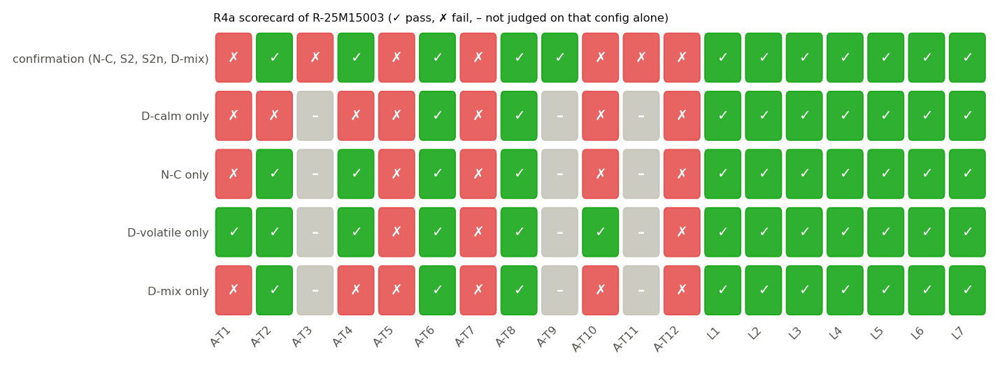
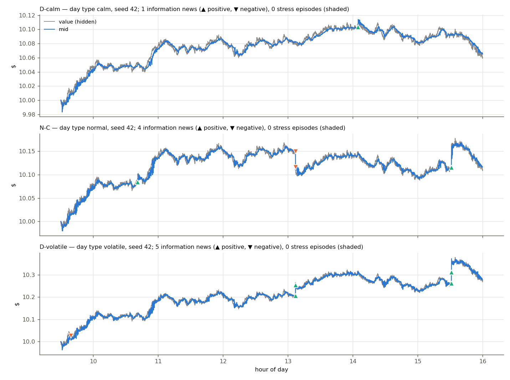
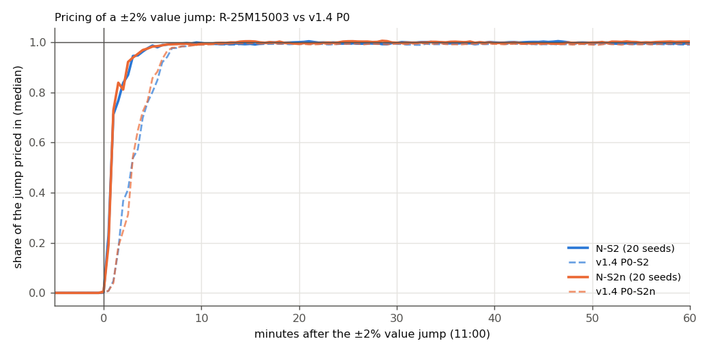
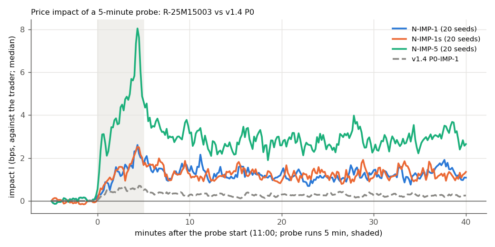

# R4a results: the living market (spec v1.5 Part A, A8 / A9.2)

Runs on engine `v1.4-d498ee4` (report written by `v1.4-d498ee4+dirty`); date 2026-10-17; selected design **R-25M15003** (A7) = 2 LPs of $5M, 1,500 retail traders, κ_v 3, P0's 60 informed (D-60fl2M, informed_budget_v2) and 12 momentum agents, living_v1 value with auto news, budget L = 2. Confirmation campaign a-confirm (A9.1): 240 runs. Medians over seeds; scenario rows are treated minus N-C of the same seed.

## Verdict (A8.4): FAIL — STOP after A9.2 and report to the owner

Failing: A-T1, A-T3, A-T5, A-T7, A-T10, A-T11, A-T12. Targets passed 5/12.

## R4a scorecard (A8.1 targets, A8.2 limits)



| id | measure | value(s) (20-seed medians) | v1.4 | result |
|---|---|---|---|---|
| A-T1 | 1-min volatility sigma_1m (bps) | C.sigma_1m_bps = 4.86 >= 5; C.sigma_1m_bps = 4.86 <= 10 | 0.62 | **FAIL** |
| A-T2 | |ac1| of 1-min returns | C.ac1 = 0.013 abs<= 0.1 | 0.005 | **PASS** |
| A-T3 | daily volatility across seeds, default day mix (%) | MIX.sigma_day_xseed = 0.988 >= 1; MIX.sigma_day_xseed = 0.988 <= 2 | 0.20% | **FAIL** |
| A-T4 | VR(5) | C.vr5 = 1.22 >= 0.8; C.vr5 = 1.22 <= 1.25 | 1.2488 | **PASS** |
| A-T5 | price/value vol ratio at 1 min | C.vol_ratio_price_value = 0.81 >= 0.9 | 0.49 | **FAIL** |
| A-T6 | volume-volatility Spearman | C.vv_corr = 0.76 >= 0.3 | +0.53 | **PASS** |
| A-T7 | clustering CS and PS | C.cs = 0.0645 >= 0.1; C.ps = 0.000807 > 0.03 | 0.087 / 0.032 | **FAIL** |
| A-T8 | excess kurtosis | C.kurt = 15.3 >= 3 | 1.47 | **PASS** |
| A-T9 | after a ±2% jump: volume uplift, spread ratio, one-sided share | S2.volume_uplift = 1.05 > 1; S2.spread_jump_ratio = 2.49 <= 3; S2.one_sided_share_jump = 0 <= 0.01; S2n.volume_uplift = 1.03 > 1; S2n.spread_jump_ratio = 2.98 <= 3; S2n.one_sided_share_jump = 0.000555 <= 0.01 | 2.5 / 15 / 0 | **PASS** |
| A-T10 | informed P&L vs hold > 0 (total, median); MM group P&L median >= 0 ($) | C.fund_pnl_total = 28,658 > 0; C.fund_pnl_median = 609 > 0; C.mm_pnl_group_median = -3,572 >= 0 | +$1,023 / −$107 | **FAIL** |
| A-T11 | regimes across days RS = p90/p10 of daily realised vol | MIX.day_rv_regime_spread = 2.4 >= 2.5 | new | **FAIL** |
| A-T12 | intraday U-shape u_ratio | C.u_ratio = 1.19 >= 1.3 | 1.14 | **FAIL** |
| L1 | spread median and p95 (bps) | C.spread_med_bps = 0.998 <= 2.5; C.spread_p95_bps = 3.87 <= 10; MIX.spread_med_bps = 0.986 <= 2.5; MIX.spread_p95_bps = 3.54 <= 10 | | **PASS** |
| L2 | shares executed per day | C.shares_executed = 1,316,600 >= 295500 | | **PASS** |
| L3 | trades all day (share of half-hours with trades; empty book at the open) | C.active_halfhours_share = 1 >= 1 | | **PASS** |
| L4 | zero_sum = 0 and invariant flags pass in every run (1 = yes) | C.zero_sum_all_zero = 1 >= 1; C.flags_all_ok = 1 >= 1 | | **PASS** |
| L5 | median wall time of a full day (s) | C.wall_time_s = 20.3 <= 90 | | **PASS** |
| L6 | max |mid - value| over a day without a scenario ($) | C.max_abs_gap = 4.47 <= 10 | | **PASS** |
| L7 | retail share of volume (%) | C.retail_share = 6.61 >= 5; C.retail_share = 6.61 <= 40 | | **PASS** |

L4 detail: invariant flags failing in any of the 240 runs: none (informed_bounds failing in 0 runs; kept for information, the budget rule is judged by informed_budget — DECISIONS A7). L5: median wall time 2e+01 s (2 workers; goal ≤ 30 s), median peak memory 7e+02 MB.

## Why it fails (evidence)

- **A-T1** 1-min volatility sigma_1m (bps): C.sigma_1m_bps = 4.86 >= 5 → FAIL; C.sigma_1m_bps = 4.86 <= 10 → PASS
- **A-T3** daily volatility across seeds, default day mix (%): MIX.sigma_day_xseed = 0.988 >= 1 → FAIL; MIX.sigma_day_xseed = 0.988 <= 2 → PASS
- **A-T5** price/value vol ratio at 1 min: C.vol_ratio_price_value = 0.81 >= 0.9 → FAIL
- **A-T7** clustering CS and PS: C.cs = 0.0645 >= 0.1 → FAIL; C.ps = 0.000807 > 0.03 → FAIL
- **A-T10** informed P&L vs hold > 0 (total, median); MM group P&L median >= 0 ($): C.fund_pnl_total = 28,658 > 0 → PASS; C.fund_pnl_median = 609 > 0 → PASS; C.mm_pnl_group_median = -3,572 >= 0 → FAIL
- **A-T11** regimes across days RS = p90/p10 of daily realised vol: MIX.day_rv_regime_spread = 2.4 >= 2.5 → FAIL
- **A-T12** intraday U-shape u_ratio: C.u_ratio = 1.19 >= 1.3 → FAIL

## Per day type (A8.3)



| measure | D-calm (calm, 10 seeds) | N-C (normal, 20 seeds) | D-volatile (volatile, 10 seeds) | D-mix (auto (mix), 20 seeds) |
|---|---|---|---|---|
| σ1m (bps) | 3 | 4.9 | 8.6 | 4.2 |
| day realised vol (%) | 0.59 | 0.96 | 1.7 | 0.82 |
| daily sd across seeds (%) | 0.87 | 1.2 | 2.1 | 0.99 |
| RS = p90/p10 day rv | 2.5 | 2.5 | 2.8 | 2.4 |
| ac1 | 0.122 | 0.013 | -0.062 | 0.0789 |
| VR(5) | 1.43 | 1.22 | 1 | 1.33 |
| vol ratio 1 min | 0.71 | 0.81 | 0.9 | 0.74 |
| vv Spearman | 0.72 | 0.76 | 0.79 | 0.75 |
| CS | 0.0422 | 0.0645 | 0.0973 | 0.0603 |
| PS | 0.000745 | 0.000807 | 0.00526 | 0.00322 |
| excess kurtosis | 4e+01 | 2e+01 | 1e+01 | 3e+01 |
| u_ratio | 1.2 | 1.2 | 1.2 | 1.2 |
| spread median (bps) | 0.69 | 1 | 1.5 | 0.99 |
| spread p95 (bps) | 2.2 | 3.9 | 7.1 | 3.5 |
| shares/day | 1,073,030 | 1,316,600 | 1,648,287 | 1,248,766 |
| max |mid − value| ($) | 4.3 | 4.5 | 7.4 | 4.6 |
| retail share (%) | 8 | 7 | 6 | 7 |
| MM share (%) | 1e+01 | 1e+01 | 9 | 1e+01 |
| MM max |inventory| (sh) | 1,407 | 1,342 | 1,198 | 1,348 |
| informed P&L total ($) | 19,227 | 28,658 | 38,654 | 21,727 |
| informed P&L median ($) | 3e+02 | 6e+02 | 1,210 | 4e+02 |
| MM group P&L ($) | -3,007 | -3,572 | 1,325 | -4,655 |
| retail P&L total ($) | -15,983 | -26,353 | -38,478 | -17,232 |
| momentum P&L total ($) | 2e+02 | 1e+02 | 2e+02 | 1e+02 |
| info news per day | 3 | 2 | 5 | 2 |
| info news f10 | 0.89 | 0.86 | 0.87 | 0.88 |
| info news volume uplift | 1.6 | 1.5 | 1.3 | 1.5 |
| stress episodes per day | 0 | 0 | 1 | 0 |
| stop users triggered (%) | 0 | 0 | 0 | 0 |
| gap std ($) | 0.38 | 0.54 | 0.89 | 0.51 |
| gap half-life read (min) | 2 | 1 | 0.9 | 1 |
| regime contrast (per day) | 5 | 3.8 | 4.3 | 4.6 |
| wall time (s) | 2e+01 | 2e+01 | 2e+01 | 2e+01 |
| day types drawn (calm/normal/volatile) | 10/0/0 | 0/20/0 | 0/0/10 | 8/11/1 |

Screened targets and limits on each day-type config alone (no jump scopes; – = not judged):

| config | A-T1 | A-T2 | A-T4 | A-T5 | A-T6 | A-T7 | A-T8 | A-T9 | A-T10 | A-T12 | L1 | L2 | L3 | L4 | L5 | L6 | L7 |
|---|---|---|---|---|---|---|---|---|---|---|---|---|---|---|---|---|---|
| D-calm | ✗ | ✗ | ✗ | ✗ | ✓ | ✗ | ✓ | – | ✗ | ✗ | ✓ | ✓ | ✓ | ✓ | ✓ | ✓ | ✓ |
| N-C | ✗ | ✓ | ✓ | ✗ | ✓ | ✗ | ✓ | – | ✗ | ✗ | ✓ | ✓ | ✓ | ✓ | ✓ | ✓ | ✓ |
| D-volatile | ✓ | ✓ | ✓ | ✗ | ✓ | ✗ | ✓ | – | ✓ | ✗ | ✓ | ✓ | ✓ | ✓ | ✓ | ✓ | ✓ |
| D-mix | ✗ | ✓ | ✗ | ✗ | ✓ | ✗ | ✓ | – | ✗ | ✗ | ✓ | ✓ | ✓ | ✓ | ✓ | ✓ | ✓ |

## Scenarios: ±2% value jump and hype news (normal day)



| measure | N-S2 (+2%) | N-S2n (−2%) | v1.4 P0-S2 | v1.4 P0-S2n |
|---|---|---|---|---|
| t50 | 0.733 | 0.733 | 2.62 | 2.86 |
| t90 | 1.86 | 1.48 | 5.64 | 5.12 |
| settle | 0.997 | 1 | 0.992 | 0.993 |
| overshoot | 0.03 | 0.0324 | 0.00832 | 0.0116 |
| volume_uplift | 1.05 | 1.03 | 2.54 | 2.58 |
| vol_uplift | 8.79 | 10.1 | 47.8 | 45.7 |
| spread_jump_ratio | 2.49 | 2.98 | 14.8 | 16 |
| one_sided_share_jump | 0 | 0.000555 | 0 | 0 |
| spread_p95_jump_bps | 8.14 | 8.81 | 14.6 | 15.8 |
| belief_5 | 0.984 | 0.985 | 0.779 | 0.763 |
| belief_30 | 0.999 | 1 | 0.999 | 1 |

Hype news +0.9 at 11:00 (N-S4 vs N-C; R in bps):

| measure | N-S4 | v1.4 P0-S4 |
|---|---|---|
| R_peak | 21.6 | 5.54 |
| t_peak | 0.267 | 0.267 |
| t_half_rev | 0.767 | 1.12 |
| R_60 | -0.011 | -0.0197 |
| belief_shift_fund_median | 1.11 | 0.822 |
| mom_dv_median | 2.16e-07 | 2.37e-07 |

## Impact (A6.2 set, four sizes)



| config | q (share of daily volume) | I_end | I_peak | I_perm | recovery | fill rate | shortfall bps |
|---|---|---|---|---|---|---|---|
| N-IMP-0 | 7.6e-05 | -0.175 | 1.12 | 0.0844 | 0.0436 | 1 | 3.76 |
| N-IMP-0.1 | 0.000456 | 0.0545 | 1.27 | 0.151 | 0.0923 | 1 | 3.58 |
| N-IMP-0.5 | 0.00228 | 0.785 | 2.61 | 0.733 | 0.285 | 1 | 4.4 |
| N-IMP-1 | 0.00456 | 2.07 | 3.85 | 1.52 | 0.357 | 1 | 5.25 |
| N-IMP-5 | 0.0228 | 3.87 | 10.1 | 3.15 | 0.289 | 0.486 | 11.8 |
| N-IMP-1s | 0.00456 | 1.8 | 4.33 | 1.52 | 0.342 | 1 | -0.681 |

Noise floor (N-IMP-0): I_end 1.81 bps, I_perm 0.392 bps. Impact β (I_end on q, four sizes, 20 seeds): **1.1** [0.939–1.86] → G12 FAIL; β on I_peak 0.529. Recovery N-IMP-1: **0.357** → G13 PASS (v1.4: G12 β 0.29, recovery as in docs/v1.4/lab/RESULTS.md).

Who absorbed the probe (median shares per class):

| class | N-IMP-1 | N-IMP-1s | N-IMP-5 |
|---|---|---|---|
| FundamentalistAgent | 4,449 | 4,016 | 9,332 |
| LiquidityProviderAgent | 1,551 | 1,977 | 5,101 |
| MomentumEKFAgent | 2e+01 | 2e+01 | 2e+01 |
| RetailTraderAgent | — | — | 6 |

## Each component alone (A3.7, A4.5, A5.5)

| component (10 seeds, normal day / synthetic_ou) | σ1m bps | vol ratio | CS | u_ratio | kurt | spread ratio (S2) | retail % | MM P&L $ |
|---|---|---|---|---|---|---|---|---|
| P0 (v1.4) (a-env) | 0.62 | 0.49 | 0.0872 | 1.1 | 2 | 12 | 0 | 2e+02 |
| a-env (a-env) | 5 | 0.8 | 0.0532 | 1.2 | 1e+01 | 1.9 | 0 | -28,819 |
| P0 (v1.4) (a-retail) | 0.62 | 0.49 | 0.0872 | 1.1 | 2 | 12 | 0 | 2e+02 |
| a-retail (a-retail) | 0.62 | 0.49 | 0.089 | 1 | 2 | 17 | 4 | 7e+02 |
| P0 (v1.4) (a-lp) | 0.62 | 0.49 | 0.0872 | 1.1 | 2 | 12 | 0 | 2e+02 |
| a-lp (a-lp) | 0.5 | 0.4 | 0.12 | 1.1 | 1 | 19 | 0 | -4,438 |

Details: `RESULTS_a-env.md`, `RESULTS_a-retail.md`, `RESULTS_a-lp.md`.

## Sweep and selection (A7)

A7 swept 16 designs × C/S2 × 5 seeds (160 runs) and refined 4 (40 runs); full tables, the selection printout and main effects in `RESULTS_a-sweep.md`. Sweep winner R-25M15003; final (after refinement) **R-25M15003**.

Refinement selection printout:

```
Refinement (spec v1.5 A7): the winner R-25M15003 and R-35M15003, R-250M15003, R-25M30003, R-25M15005, same seeds, same rule.

Step 1 — reject designs failing any limit L1, L2, L3, L4, L5, L6, L7 (L1 on the normal day only):
  R-25M15003: kept
  R-35M15003: kept
  R-250M15003: REJECTED (L7: C.retail_share=3.8 >= 5 FAIL)
  R-25M30003: REJECTED (L6: C.max_abs_gap=20.7 <= 10 FAIL)
  R-25M15005: kept

Step 2 — number of targets passed among A-T1, A-T2, A-T4, A-T5, A-T6, A-T7, A-T8, A-T9, A-T10, A-T12 (A-T3, A-T11 need the day mix; A-T9 on S2 only):
  R-25M15003: 5 (A-T2, A-T4, A-T6, A-T8, A-T9)
  R-35M15003: 3 (A-T2, A-T6, A-T8)
  R-25M15005: 4 (A-T2, A-T6, A-T8, A-T9)
  maximum 5: ['R-25M15003']

Winner: R-25M15003
```

## Pre-registered expectations E-A1..E-A10 (A10)

| id | expectation | measured | verdict |
|---|---|---|---|
| E-A1 | living_v1 alone: σ1m ≈ 3 bps, vol ratio ≈ 0.5 | a-env σ1m 5 bps, vol ratio 0.8 | NOT CONFIRMED |
| E-A2 | crowd alone raises CS and the U-shape; κ_v 3 more than 1 | a-retail CS 0.089 vs P0 0.0872; u 1 vs 1.1; sweep effect κ_v 3−1 on CS 0.00545, on u 0.00371 | NOT CONFIRMED |
| E-A3 | LPs alone cut the post-jump spread ratio below 5 | a-lp spread_jump_ratio 19 | NOT CONFIRMED |
| E-A4 | combined: A-T5 rises toward 0.9 (v1.4 0.49) | N-C vol ratio 0.81 | NOT CONFIRMED |
| E-A5 | excess kurtosis ≥ 3 | N-C 2e+01 | CONFIRMED |
| E-A6 | MMs earn a small positive P&L; informed profit; retail loses on average | MM group $-3,572, informed $28,658, retail $-26,353 (N-C medians) | NOT CONFIRMED |
| E-A7 | impact β moves toward 0.5–0.7 (v1.4 0.29) | β 1.1 | NOT CONFIRMED |
| E-A8 | wall time ≤ 40 s per day | median 2e+01 s over all 240 runs (2 workers) | CONFIRMED |
| E-A9 | stop-losses trigger for < 5% of stop users per normal day | N-C median 0% | CONFIRMED |
| E-A10 | A-T4 (VR(5)) is the most fragile target | A-T4 PASS (VR(5) 1.22); targets failing: A-T1, A-T3, A-T5, A-T7, A-T10, A-T11, A-T12 | NOT CONFIRMED |

## Completeness

| config | valid seeds | zero_sum ≠ 0 | flags failing | wall time median (s) | errors |
|---|---|---|---|---|---|
| D-mix | 20/20 | 0 | 0 | 21 |  |
| D-calm | 10/20 | 0 | 0 | 20.8 |  |
| D-volatile | 10/20 | 0 | 0 | 20.6 |  |
| N-C | 20/20 | 0 | 0 | 17.5 |  |
| N-S2 | 20/20 | 0 | 0 | 20.1 |  |
| N-S2n | 20/20 | 0 | 0 | 21.2 |  |
| N-IMP-0 | 20/20 | 0 | 0 | 20.2 |  |
| N-IMP-0.1 | 20/20 | 0 | 0 | 20 |  |
| N-IMP-0.5 | 20/20 | 0 | 0 | 20.1 |  |
| N-IMP-1 | 20/20 | 0 | 0 | 20.3 |  |
| N-IMP-5 | 20/20 | 0 | 0 | 20.1 |  |
| N-IMP-1s | 20/20 | 0 | 0 | 20.2 |  |
| N-S4 | 20/20 | 0 | 0 | 20.7 |  |

(D-calm and D-volatile run on the first 10 lab seeds only, A9.1.)

